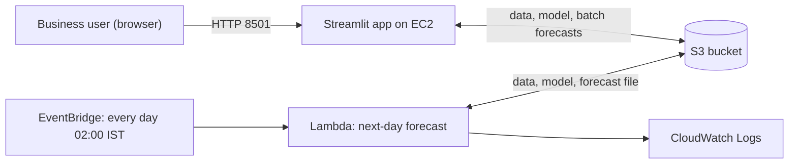

# Cloud Retail Sales Forecaster

This project predicts the daily sales of each product in each store of a retail shop. A shop owner can use the forecast to plan how much stock they needS to buy.

It has two parts:

- a **web app** where a user can see the history and a 30-day forecast, and
- a **daily job on AWS** that saves a new forecast file every night.

I built it for the TCS iON Industry Project 45 (Cloud Retail Sales Forecaster).

**Author:** Faisal Shah

## Links

| What | Link |
|---|---|
| Live app | http://13.238.69.97:8501/ (open until the project evaluation; plain HTTP, no login) |
| Demo video | TODO: add the video link here |
| Project report | Submitted on the TCS iON portal |

## What the project does

- Reads daily sales data: date, store, product and units sold.
- Predicts sales for the next 30 days and shows a confidence band.
- Shows how accurate the model is (MAE, MAPE and WAPE).
- Warns the user when the sales history is too short (less than 30 days).
- Every day at 02:00 IST, an AWS Lambda job saves tomorrow's forecast for all 500 store-product series in S3.

## How it is built



- The data, the saved model and the forecast files are stored in one S3 bucket.
- The Streamlit app runs on an EC2 server as a service. It starts again by itself if the server restarts.
- The Lambda function runs every day. It loads the model and the latest sales file from S3, makes tomorrow's forecast for every series, and saves `forecasts/forecast_YYYYMMDD.csv`.
- Everything runs in the AWS Sydney region (ap-southeast-2).

## Data

I used the Kaggle **Store Item Demand Forecasting Challenge** data:

- 913,000 daily rows
- 10 stores and 50 products, so 500 series
- from 1 January 2013 to 31 December 2017

The data is **not** included in this repository. Download it from Kaggle (please read the Kaggle terms) and save it as `data/raw/train.csv`.
I renamed the columns to `date`, `store_id`, `product_id` and `sales_qty`, and wrote the IDs as `S001` and `P001`.

## How the model works

1. **Split by date, not at random.** Train: until 1 Jul 2016. Validation: until 1 Apr 2017. Test: after that. A random split would let the model see the future, and the scores would look better than they really are.
2. **Features.** Sales 1, 7, 14 and 28 days ago. The average of the last 7 and 14 days (without today). Day of week, weekend, month, and the store and product number.
3. **Models.** Naive (same as yesterday), seasonal naive (same as last week), Linear Regression and Random Forest.
4. **Checks.** MAE, MAPE and WAPE, and a backtest with 3 folds in different seasons.
5. **Final model.** Random Forest with 100 trees, depth 12, leaf size 20 (about 14.6 MB).
6. **30-day forecast.** Each predicted day is used to predict the next day. The confidence band is built from real past errors, scaled by the square root of the forecast.

### Results on the test period (April to December 2017)

| Model | MAE | MAPE % | WAPE % |
|---|---|---|---|
| Naive (lag 1) | 11.80 | 21.94 | 18.72 |
| Seasonal naive (lag 7) | 9.21 | 17.33 | 14.61 |
| Linear regression | 7.00 | 13.17 | 11.10 |
| **Random forest (used)** | **6.71** | **12.67** | **10.64** |

- The Random Forest has about 27% lower error than "same day last week".
- The order of the models was the same on validation, in all 3 backtest folds, and on test.
- For 30-day forecasts, the average error was 6.98 units a day, against 9.71 for seasonal naive.
- The 80% band covered 82% of real days on a start date that was not used to build the band.
- Two ideas did not help, and I did not keep them: tuning the forest (almost no change) and adding day-of-year features (less than 1% better).

## Repository structure

```
src/         data preparation, features, training, tuning, backtest, forecasting code
app/         Streamlit app
lambda_fn/   Lambda handler for the daily job
scripts/     Lambda package builder and smoke test
tests/       automated tests
models/      saved model (v1), its metadata, and the band settings
docs/        figures and result tables
```

## Run it on your computer

Use Python 3.14 (the app and the Lambda use it). Run all commands from the main folder of the repository.

```
pip install -r requirements.txt
python -m src.data_prep        # needs data/raw/train.csv
python -m src.train
python -m src.finalize
streamlit run app/streamlit_app.py
```

**Try the app without AWS:** open the app, choose **Upload CSV**, and upload `docs/sample_upload.csv`. The model files are in the `models/` folder.
The option **Fetch from S3** needs access to my private S3 bucket, so it will not work on another account.

## Tests

```
pip install pytest
python -m pytest -q
```

There are 7 tests. They check that:

- the features used for prediction are the same as in training,
- a short history shows a warning but still gives a forecast,
- flat demand gives a forecast close to the average,
- a weekly pattern in the data is followed,
- missing dates are filled,
- empty data gives a clear error, and
- the confidence band is around the forecast and never below zero.

All 7 pass on my laptop and on the EC2 server.

## Deployment

- **Lambda** `retail-forecaster-daily`: Python 3.14, x86_64, 1,536 MB. EventBridge runs it every day at 20:30 UTC (02:00 IST). A run takes about 2 seconds.
  To build the package (Linux libraries, under the 250 MB limit):

  ```
  pip install --target build/deps --only-binary=:all: --python-version 3.14 --implementation cp --platform manylinux_2_28_x86_64 --platform manylinux_2_27_x86_64 --platform manylinux2014_x86_64 scikit-learn==1.9.1 numpy==2.5.4 pandas==3.1.1 joblib==1.6.0
  pip install --target build/deps --upgrade --no-deps "python-dateutil<3"
  python scripts/build_lambda_zip.py
  ```

  Then upload the zip to S3 and update the function.
- **App** on EC2 (`t3.small`, Amazon Linux 2023) as a `systemd` service on port 8501. To update it:

  ```
  cd ~/retails-sales-forecaster && git pull && sudo systemctl restart forecaster
  ```

- **Security:** IAM roles with only the S3 access they need, no access keys on the servers, no SSH port (Session Manager is used), and only port 8501 is open. No secrets are stored in this repository.
- **Smoke test** of the live system (checks the app and the newest daily file):

  ```
  python scripts/smoke_test.py http://13.238.69.97:8501
  ```

## Known limits

- The app uses plain HTTP and has no login. Anyone with the link can use it.
- The dataset does not change, so the daily job gives the same forecast date every day.
- The data is anonymous, so I could not add a holiday calendar.
- The confidence band was built from a sample (40 series, 3 start dates). For one small series, it may cover more or fewer real days than 80%.
- One server, one region, no auto-scaling.

## Notes

- The sales data comes from Kaggle and is not part of this repository.